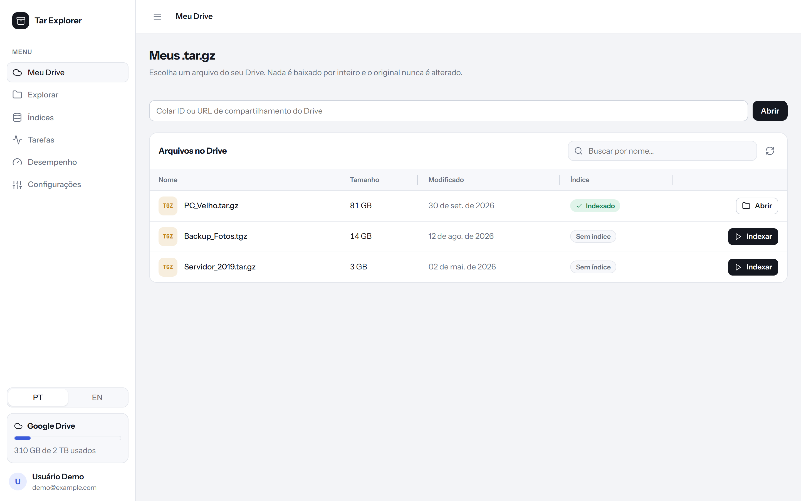
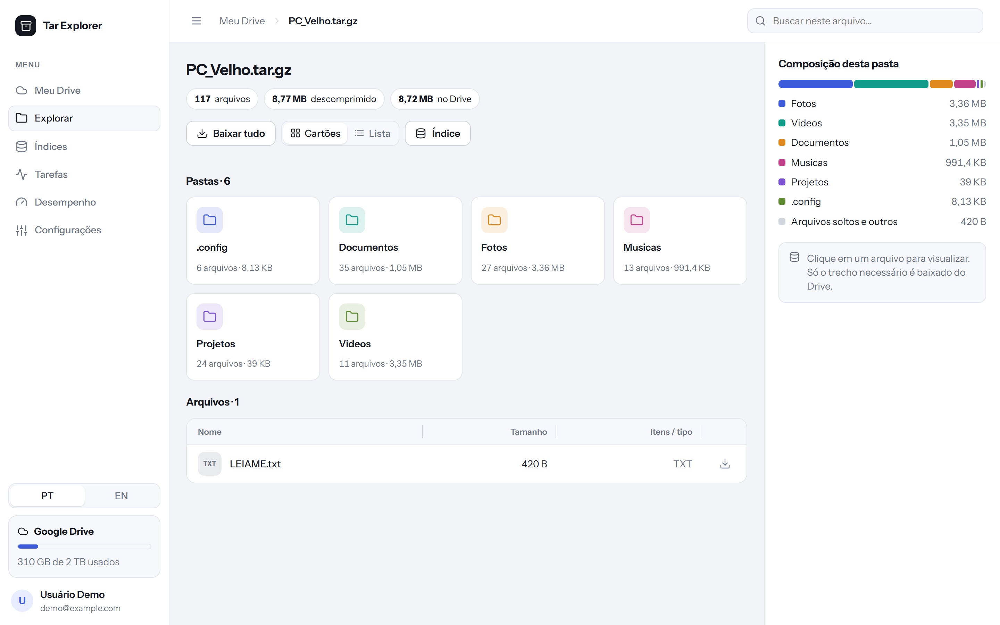
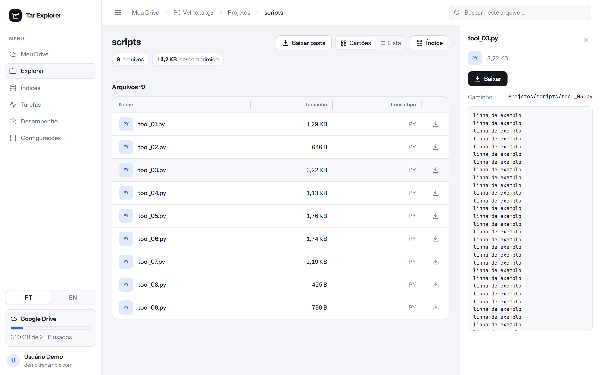
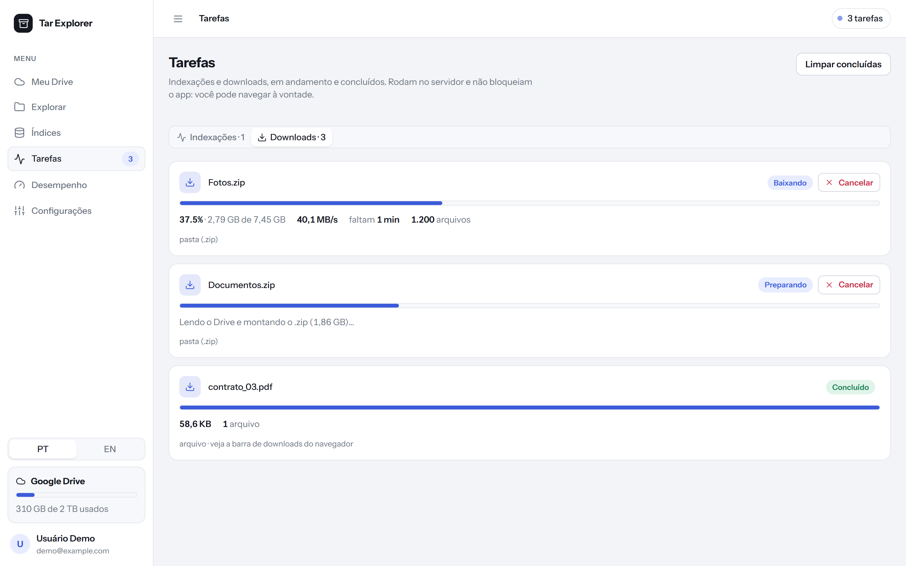
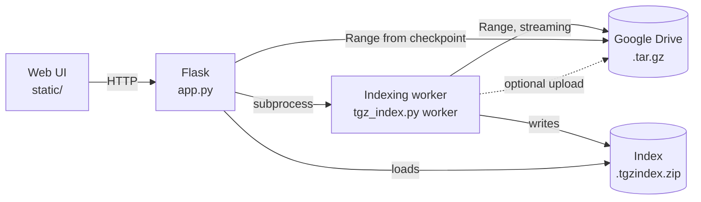

# Tar Explorer

**English** · [Português (Brasil)](README.pt-BR.md)

Browse, search, preview and download files from inside a `.tar.gz` stored on Google Drive, **without downloading the whole archive, without writing the `.tar.gz` to disk and without changing anything on Drive**.


## Screenshots

> Captured with demo data. The UI is shown in Portuguese; switch to English in the sidebar or in Settings.

| My Drive | Explore |
| --- | --- |
|  |  |

| File preview | Tasks (indexing and downloads) |
| --- | --- |
|  |  |

## Why it exists

An 80 GB `.tar.gz` backup on Drive is a problem when your local disk can't even hold the archive. gzip has no random access: to reach a file in the middle you have to decompress everything before it. Tar Explorer solves this in two steps:

1. **One streaming pass** reads the archive over the network (bytes go through RAM and are discarded) and builds a small **index**.
2. **Once indexed**, the folder tree opens instantly and each file is read with `Range` requests, starting from the nearest checkpoint, fetching only the bytes it needs.

## Features

| Area | What it does |
| --- | --- |
| **My Drive** | Lists your `.tar.gz`/`.tgz` files with their index state (indexed, no index, indexing %). Sortable, resizable columns. |
| **Explore** | Folders as cards or a list, breadcrumb, path search, folder composition by size. |
| **Preview and download** | Text preview (with a loader) and download of any file, reading only its slice. |
| **Download folder** | Downloads a whole folder (or the entire archive) as a `.zip` generated on the fly, writing nothing to disk on the server. |
| **Indexes** | Manage local indexes: open folder, rebuild, delete. |
| **Tasks** | Two tabs: **Indexing** and **Downloads**, with progress, speed, time remaining and cancel. They run in the background and never block the app. |
| **Performance** | Benchmark of connections × block size, and one click to apply the best setting. |
| **Settings** | Language, indexes folder, checkpoint spacing, index upload to Drive, connections, block size and preview limit. |

Other highlights:

- **Read-only on the original.** The index is a new file (`<name>.tgzindex.zip`), saved locally and, if you want, uploaded next to the original on Drive.
- **Isolated indexing.** It runs in a separate process. Cancelling kills only that process and the web server keeps running.
- **Files larger than 2 GiB on Windows.** Uses [`rapidgzip`](https://github.com/mxmlnkn/rapidgzip), which is 64-bit (`indexed_gzip` fails on files that large on Windows).
- **Multilingual:** Portuguese (Brazil) and English (US), switchable from the sidebar or Settings. The default follows the browser language. To add a language, add a dictionary to `MSG` in `static/app.js`.
- **Downloads that don't freeze the UI.** The browser downloads normally while the server tracks each download; follow it under **Tasks › Downloads** (and in the top badge) while you keep browsing.
- **Light/dark theme** that follows the system, and a responsive layout.

## How it works



The index is a `.zip` with three parts:

- `members.json.gz`: a `[path, size, is_dir, offset]` table for every tar member.
- `index.gzidx`: gzip checkpoints (`rapidgzip`) that let reads jump into the middle of the archive.
- `meta.json`: summary (name, size, number of members).

## Requirements

- Python 3.10 or newer
- A Google account with access to the file
- A Google Cloud project with the **Google Drive API** enabled

## Installation

```bash
git clone https://github.com/ffcro3/tar-explorer.git
cd tar-explorer
python -m venv .venv
# Windows: .venv\Scripts\activate   |   Linux/macOS: source .venv/bin/activate
pip install -r requirements.txt
```

## Authentication

1. In the [Google Cloud Console](https://console.cloud.google.com/), enable the **Google Drive API**.
2. Under *OAuth consent screen*, add your email as a test user and include the scopes below.
3. Under *Credentials*, create an **OAuth client ID** of type **Desktop app**, download the JSON and save it as `credentials.json` in the project root.
4. Run the app. On first run your browser opens for you to authorize, and the token is stored in `token.json`.

| Scope | Used for |
| --- | --- |
| `drive.readonly` | Reading the `.tar.gz` and listing your files. |
| `drive.file` | Creating and reading **only** the index file created by the app. |

To switch accounts or scopes, delete `token.json`. A service account also works: `python app.py --service-account key.json` (the file must be shared with the service account's email).

> `credentials.json`, `token.json` and `settings.json` are in `.gitignore`. **Never commit them.**

## Usage

```bash
python app.py
```

Open <http://127.0.0.1:5000>.

1. In **My Drive**, pick the file and click **Index** (or paste its ID / sharing URL).
2. Follow it under **Tasks**. Indexing reads the archive exactly once and can be cancelled at any time.
3. When it finishes, **Explore** opens the tree instantly. Click a file to preview or download it; use the download icon (or **Download folder**) to get whole folders as `.zip`.
4. Downloads show up under **Tasks › Downloads**, with progress and a cancel option.

Command-line options:

| Option | Description |
| --- | --- |
| `--port N` | Server port (default `5000`). |
| `--host ADDR` | Listen address (default `127.0.0.1`). Use `0.0.0.0` to allow access from your network. Also read from `TGZ_HOST` or a `host` key in `settings.json`. |
| `--index-dir FOLDER` | Local indexes folder (overrides the saved setting). |
| `--service-account JSON` | Use a service account instead of OAuth. |
| `--client-secret FILE` | Path to `credentials.json`. |

## Configuration

Everything can be changed on the **Settings** screen and is saved to `settings.json`. Changes apply immediately.

| Key | Default | Description |
| --- | --- | --- |
| `index_dir` | `./cache` | Local indexes folder. The app checks it can write there before saving. |
| `spacing_mb` | `32` | Distance between checkpoints, in MB of the compressed file. Smaller = faster extraction, bigger index. |
| `upload` | `true` | Upload the index to Drive, in the same folder as the original. |
| `chunk_mb` | `16` | Size of each `Range` request. |
| `ahead` | `8` | Parallel download connections. Memory used ≈ `chunk_mb × ahead`. |
| `preview_kb` | `512` | Text preview limit. |

Environment variables (initial values): `TGZ_INDEX_DIR`, `TGZ_CHUNK_MB`, `TGZ_AHEAD`.

### Performance

Drive throttles speed per connection, so throughput scales with parallelism up to a point and then gets worse as Drive starts rejecting requests. Use the **Performance** tab (or `python tgz_index.py bench <ID>`) to find the best combination for your account and your internet. In general, 8 to 16 simultaneous connections works best. Decompression on a single core stays above 300 MB/s, so the network is usually the bottleneck.

## CLI

The web UI covers everything, but the utilities are still available:

```bash
python tgz_index.py build <ID_OR_URL> [--index-dir FOLDER] [--no-upload] [--spacing-mb 32]
python tgz_index.py bench <ID_OR_URL>
python tgz_index.py info  <ID_OR_URL>

python gdrive_targz_stream.py <ID_OR_URL> --list
python gdrive_targz_stream.py <ID_OR_URL> --extract path/file.txt --out output/
```

## Project structure

```
.
├── app.py                    # Flask server and API
├── tgz_index.py              # indexing, index, tree, search, benchmark and CLI
├── gdrive_targz_stream.py    # authentication and Drive reads via Range (streaming)
├── docs/                     # README screenshots
├── README.pt-BR.md           # README in Portuguese
├── static/
│   ├── index.html
│   ├── app.css               # design tokens, light/dark theme, responsive
│   └── app.js                # UI (no dependencies), includes pt-BR / en-US strings
├── requirements.txt
└── .gitignore
```

## Limitations

- **The first pass reads the whole archive.** There is no shortcut: the tar lives inside a single gzip stream. Time depends on your network and Drive's limits.
- **Large indexes use memory.** With millions of files the in-memory tree can take hundreds of MB and the first open takes a few seconds.
- **Extracting a file** downloads and decompresses up to `spacing_mb` MB before the target.
- Folder `.zip` files are generated on the fly, uncompressed (files are stored as-is) and with zip64, so there is no size limit. The final size is slightly larger than the sum of the files.
- If indexing is interrupted, it restarts from scratch.
- By default the server listens only on `127.0.0.1`. It has **no authentication of its own** because it uses your Drive access, so anyone who can reach the port can browse and download your files. If you enable network access (`--host 0.0.0.0`), do it only on a trusted private network and allow the port only on private networks in your firewall.

## Troubleshooting

| Symptom | What to do |
| --- | --- |
| `ZranError: zran_init returned error` | You're on an old version that used `indexed_gzip`. Update and run `pip install -r requirements.txt`. |
| Index upload fails | Delete `token.json` and authorize again (the `drive.file` scope is missing). The local index stays valid. |
| `access_denied` on login | Add your email as a test user on the OAuth consent screen. |
| Slow speed | Run the benchmark on the **Performance** tab and apply the best setting. |
| Invalid folder / no permission | Pick another indexes folder in **Settings**. |
