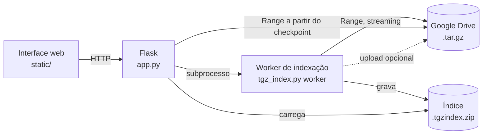

# Tar Explorer

Navegue, pesquise, visualize e baixe arquivos de dentro de um `.tar.gz` guardado no Google Drive, **sem baixar o arquivo inteiro, sem gravar o `.tar.gz` em disco e sem alterar nada no Drive**.


## Por que existe

Um backup de 80 GB em `.tar.gz` no Drive é um problema quando o disco local não comporta nem o arquivo. O formato gzip não tem acesso aleatório: para chegar a um arquivo no meio, é preciso descomprimir tudo o que vem antes. O Tar Explorer resolve isso em duas etapas:

1. **Uma passada em streaming** lê o arquivo pela rede (os bytes passam pela RAM e são descartados) e monta um **índice** pequeno.
2. **Depois do índice**, a árvore de pastas abre na hora e cada arquivo é lido por requisições `Range`, a partir do checkpoint mais próximo, baixando apenas o trecho necessário.

## Recursos

| Área | O que faz |
| --- | --- |
| **Meu Drive** | Lista seus `.tar.gz`/`.tgz` com o estado do índice (indexado, sem índice, indexando %). |
| **Explorar** | Pastas em cartões ou lista, breadcrumb, busca por caminho, composição da pasta por tamanho. |
| **Prévia e download** | Prévia de texto (com loader) e download de qualquer arquivo, lendo só o trecho dele. |
| **Baixar pasta** | Baixa uma pasta inteira (ou o arquivo todo) como `.zip` gerado em streaming, sem gravar nada em disco no servidor. |
| **Índices** | Gerencia os índices locais: abrir pasta, recriar, excluir. |
| **Tarefas** | Duas abas: **Indexações** e **Downloads**, com progresso, velocidade, tempo restante e cancelamento. Rodam em segundo plano e não bloqueiam o app. |
| **Desempenho** | Benchmark de conexões × tamanho de bloco e aplicação da melhor configuração com um clique. |
| **Configurações** | Idioma, pasta dos índices, espaçamento dos checkpoints, upload do índice ao Drive, conexões, bloco e limite da prévia. |

Outros pontos:

- **Somente leitura no original.** O índice é um arquivo novo (`<nome>.tgzindex.zip`), salvo localmente e, se você quiser, enviado à mesma pasta do original no Drive.
- **Indexação isolada.** Ela roda em um processo separado. Cancelar encerra só esse processo e o servidor web continua de pé.
- **Arquivos maiores que 2 GiB no Windows.** Usa [`rapidgzip`](https://github.com/mxmlnkn/rapidgzip), que é 64-bit (o `indexed_gzip` falha com arquivos desse tamanho no Windows).
- **Multilíngue:** português (Brasil) e inglês (EUA), com troca no menu lateral ou em Configurações. O padrão segue o idioma do navegador. Para adicionar um idioma, inclua um dicionário em `MSG` no `static/app.js`.
- **Downloads sem travar a tela.** O navegador baixa normalmente e o servidor registra cada download; acompanhe na aba **Tarefas › Downloads** (e no selo do topo) enquanto navega.
- **Tema claro/escuro** automático e layout responsivo.

## Como funciona



O índice é um `.zip` com três partes:

- `members.json.gz`: tabela `[caminho, tamanho, é_pasta, offset]` de cada membro do tar.
- `index.gzidx`: checkpoints do gzip (`rapidgzip`) que permitem saltar para o meio do arquivo.
- `meta.json`: resumo (nome, tamanho, quantidade de membros).

## Requisitos

- Python 3.10 ou superior
- Uma conta Google com acesso ao arquivo
- Um projeto no Google Cloud com a **Google Drive API** ativada

## Instalação

```bash
git clone <url-do-repositorio>
cd tar-explorer
python -m venv .venv
# Windows: .venv\Scripts\activate   |   Linux/macOS: source .venv/bin/activate
pip install -r requirements.txt
```

## Autenticação

1. No [Google Cloud Console](https://console.cloud.google.com/), ative a **Google Drive API**.
2. Em *Tela de consentimento OAuth*, adicione seu e-mail como usuário de teste e inclua os escopos abaixo.
3. Em *Credenciais*, crie um **ID do cliente OAuth** do tipo **App para computador**, baixe o JSON e salve como `credentials.json` na raiz do projeto.
4. Rode o app. Na primeira execução o navegador abre para você autorizar, e o token fica em `token.json`.

| Escopo | Para quê |
| --- | --- |
| `drive.readonly` | Ler o `.tar.gz` e listar seus arquivos. |
| `drive.file` | Criar e ler **somente** o arquivo de índice criado pelo app. |

Para trocar de conta ou de escopo, apague o `token.json`. Também é possível usar uma conta de serviço: `python app.py --service-account chave.json` (o arquivo precisa estar compartilhado com o e-mail da conta).

> `credentials.json`, `token.json` e `settings.json` estão no `.gitignore`. **Nunca os versione.**

## Uso

```bash
python app.py
```

Abra <http://127.0.0.1:5000>.

1. Em **Meu Drive**, escolha o arquivo e clique em **Indexar** (ou cole o ID/URL de compartilhamento).
2. Acompanhe em **Tarefas**. A indexação lê o arquivo uma única vez e pode ser cancelada a qualquer momento.
3. Quando terminar, **Explorar** abre a árvore na hora. Clique em um arquivo para ver a prévia ou baixar; use o ícone de download (ou **Baixar pasta**) para pastas inteiras em `.zip`.
4. Os downloads aparecem em **Tarefas › Downloads**, com progresso e opção de cancelar.

Opções de linha de comando:

| Opção | Descrição |
| --- | --- |
| `--port N` | Porta do servidor (padrão `5000`). |
| `--index-dir PASTA` | Pasta local dos índices (sobrescreve a configuração salva). |
| `--service-account JSON` | Usa conta de serviço em vez de OAuth. |
| `--client-secret ARQUIVO` | Caminho do `credentials.json`. |

## Configuração

Tudo pode ser ajustado na tela **Configurações** e é salvo em `settings.json`. Os valores têm efeito imediato.

| Chave | Padrão | Descrição |
| --- | --- | --- |
| `index_dir` | `./cache` | Pasta local dos índices. O app testa se consegue gravar antes de salvar. |
| `spacing_mb` | `32` | Distância entre checkpoints, em MB do arquivo comprimido. Menor = extração mais rápida e índice maior. |
| `upload` | `true` | Envia o índice ao Drive, na mesma pasta do original. |
| `chunk_mb` | `16` | Tamanho de cada requisição `Range`. |
| `ahead` | `8` | Conexões de download em paralelo. Memória usada ≈ `chunk_mb × ahead`. |
| `preview_kb` | `512` | Limite da prévia de texto. |

Variáveis de ambiente (valores iniciais): `TGZ_INDEX_DIR`, `TGZ_CHUNK_MB`, `TGZ_AHEAD`.

### Desempenho

O Drive limita a velocidade por conexão, então o download escala com o paralelismo até um ponto e depois piora, porque o Drive passa a recusar pedidos. Use a aba **Desempenho** (ou `python tgz_index.py bench <ID>`) para medir a melhor combinação para a sua conta e a sua internet. Em geral, algo entre 8 e 16 conexões simultâneas rende mais. A descompressão em um núcleo fica acima de 300 MB/s, então a rede costuma ser o gargalo.

## CLI

A interface web cobre tudo, mas os utilitários continuam disponíveis:

```bash
python tgz_index.py build <ID_OU_URL> [--index-dir PASTA] [--no-upload] [--spacing-mb 32]
python tgz_index.py bench <ID_OU_URL>
python tgz_index.py info  <ID_OU_URL>

python gdrive_targz_stream.py <ID_OU_URL> --list
python gdrive_targz_stream.py <ID_OU_URL> --extract caminho/arquivo.txt --out saida/
```

## Estrutura do projeto

```
.
├── app.py                    # servidor Flask e API
├── tgz_index.py              # indexação, índice, árvore, busca, benchmark e CLI
├── gdrive_targz_stream.py    # autenticação e leitura do Drive por Range (streaming)
├── static/
│   ├── index.html
│   ├── app.css               # tokens de design, tema claro/escuro, responsivo
│   └── app.js                # interface (sem dependências)
├── requirements.txt
└── .gitignore
```

## Limitações

- **A primeira passada lê o arquivo inteiro.** Não existe atalho: o tar está dentro de um único stream gzip. O tempo depende da sua rede e dos limites do Drive.
- **Índices grandes usam memória.** Com milhões de arquivos, a árvore em memória pode ocupar centenas de MB e a primeira abertura leva alguns segundos.
- **Extrair um arquivo** baixa e descomprime até `spacing_mb` MB antes do ponto desejado.
- O `.zip` de pasta é gerado na hora, sem compressão (os arquivos são guardados como estão) e com zip64, então não há limite de tamanho. O tamanho final é ligeiramente maior que a soma dos arquivos.
- Se a indexação for interrompida, ela recomeça do zero.
- O servidor escuta apenas em `127.0.0.1` e **não tem autenticação própria**, porque usa o seu acesso ao Drive. Não o exponha na rede.

## Solução de problemas

| Sintoma | O que fazer |
| --- | --- |
| `ZranError: zran_init returned error` | Você está com uma versão antiga que usava `indexed_gzip`. Atualize e rode `pip install -r requirements.txt`. |
| Falha no upload do índice | Apague o `token.json` e autorize de novo (falta o escopo `drive.file`). O índice local continua válido. |
| `access_denied` no login | Adicione seu e-mail como usuário de teste na tela de consentimento. |
| Velocidade baixa | Rode o benchmark na aba **Desempenho** e aplique a melhor configuração. |
| `Pasta inválida/sem permissão` | Escolha outra pasta para os índices em **Configurações**. |
